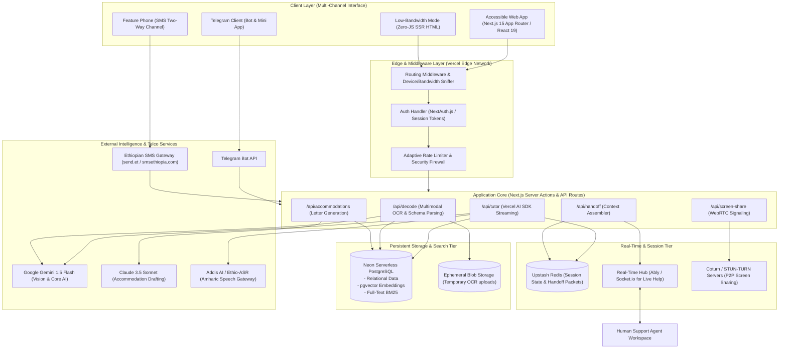
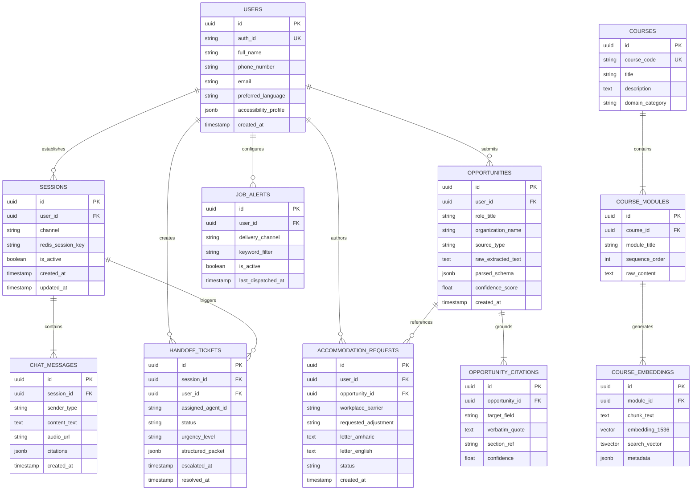

# BridgeMate — Product and Technical Blueprint
**From Learning to Earning: An Accessible, Multilingual AI-Powered Bridge for Jobseekers with Disabilities in Ethiopia**

*Submission for the Digital Bridge Accessibility Hackathon 2026*  
*Track 3: Multilingual Assistant and Live Help*  
*Date: November 14–15, 2026 | Venue: ALX Tech Hub, Addis Ababa, Ethiopia*  
*Target Grand Prize: 100,000 ETB*

---

## 1. Executive Summary

### 1.1 Project Overview
BridgeMate is an assistive, multilingual learning-to-earning platform engineered specifically for persons with disabilities in Ethiopia. While digital skilling initiatives (e.g., ALX Ethiopia, Dereja, TVET colleges, and national university programs) have trained thousands of disabled youth, the bridge from education to sustainable employment remains broken. Inaccessible job portals, image-only job circulars shared on Telegram, ambiguous physical requirements, and anxiety surrounding workplace accommodations systematically filter out disabled candidates.

BridgeMate addresses these structural failures through an AI-powered, multi-channel platform aligned with the **Digital Bridge Accessibility Hackathon 2026 Track 3 (Multilingual Assistant and Live Help)** requirements. It delivers an intelligent voice/text tutor grounded in vocational curricula, an automated job announcement interpreter, privacy-preserving accommodation request generation, and an industry-grade context-preserving escalation bridge to human guides with learner-controlled screen sharing.

```
       ┌─────────────────────────────────────────────────────────────┐
       │                        BRIDGEMATE                           │
       │               "From Learning to Earning"                    │
       └──────────────────────────────┬──────────────────────────────┘
                                      │
         ┌────────────────────────────┼────────────────────────────┐
         ▼                            ▼                            ▼
┌──────────────────┐        ┌──────────────────┐        ┌──────────────────┐
│   INNOVATION 1   │        │   INNOVATION 2   │        │   INNOVATION 3   │
│   Opportunity    │        │ Context-Preserve │        │  Accommodation   │
│     Decoder      │        │  Human Handoff   │        │    Translator    │
└────────┬─────────┘        └────────┬─────────┘        └────────┬─────────┘
         │                           │                           │
         │                           │                           │
         ▼                           ▼                           ▼
Plain-language Amharic/     1-click escalation with     Functional adjustment
English breakdown of job    hydrated context packet;    formal request letter;
circulars, unstated demand  WebRTC selective screen     zero medical diagnosis;
detection & accessibility.  sharing; async fallback.    strict user approval.
```

### 1.2 The Three Core Innovations
1. **The Opportunity Decoder**: Job announcements in Ethiopia are predominantly distributed via Telegram channels as scanned PDFs or uncompressed images without alt-text, or as dense, bureaucratic Terms of Reference (TOR). The Opportunity Decoder ingests text, images, camera captures, and document links, extracts requirements through specialized bilingual OCR, and translates them into plain Amharic and simple English. Crucially, it identifies unstated physical demands (e.g., "must conduct frequent unassisted field visits across rural woredas"), cross-references candidate accommodation profiles, provides strict source citations, and never fabricates details.
2. **Context-Preserving Human Handoff**: Automated bots that hit dead-ends often abandon disabled users or force them to re-explain their barriers to a new human agent. BridgeMate implements an enterprise-grade state-hydration pipeline using Redis. When a user escalates via one click, the system compiles a structured 4-part handoff packet (Goal, Verified Facts, Attempted Actions, Recommended Next Steps) delivered to the support agent before the WebRTC audio/chat session opens. If no human agent is online, the system truthfully reports wait times and provides a frictionless asynchronous ticket fallback.
3. **The Accommodation Translator**: Disabled candidates in Ethiopia face severe disclosure dilemmas. Under the social model of disability, an individual is disabled by workplace barriers, not their medical condition. The Accommodation Translator guides users through an interactive, non-diagnostic reflection on workplace tasks, barriers, and functional adjustments. It then drafts a professional, culturally resonant, and legally aligned reasonable accommodation request letter (in Amharic or English) under Ethiopian labor proclamations without requiring medical diagnosis disclosure.

### 1.3 Key Architectural Highlights
- **Multi-Channel & Low-Bandwidth Resilience**: Operates across an accessible responsive Web Application, a low-bandwidth zero-JavaScript text mode (<15 KB payload), an SMS interactive service via domestic gateways (`send.et` / `smsethiopia.com`), and an integrated Telegram Bot architecture.
- **Bilingual Grounded RAG Engine**: Utilizes hybrid retrieval (vector similarity via `pgvector` + BM25 sparse keyword matching) over verified educational and career preparation material, strictly enforcing cosine similarity thresholds (>0.65) to eliminate hallucinations.
- **Uncompromised Accessibility**: Engineered to exceed WCAG 2.2 Level AA standards, featuring native support for screen readers (NVDA, JAWS, TalkBack), Ethiopic/Ge'ez script typography, dynamic Right-to-Left (RTL) capability for Somali/Arabic scripts, high-contrast focus indicators, and learner-controlled WebRTC screen sharing with client-side canvas PII masking.
- **National Policy Alignment**: Built in compliance with the **Ethiopian Data Protection Proclamation (April 2024)**, the **Federal Civil Service Proclamation No. 1064/2017**, and the **Private Organization Employees Labor Proclamation No. 1156/2019**, supporting the strategic pillars of **Digital Ethiopia 2025**.

---

## 2. Problem Analysis

### 2.1 The Ethiopian Macroeconomic and Telecommunications Reality
Designing digital systems for Ethiopia requires grounding in the country's physical infrastructure and economic constraints:
- **Connectivity Realities**: National internet penetration sits between 19% and 22% (~24–28 million users). Fixed broadband accounts for less than 1% of total connections, making Ethiopia overwhelmingly a mobile-first nation (~60% mobile SIM penetration, over 77 million active SIM cards operated between Ethio Telecom and Safaricom Ethiopia).
- **Network Asymmetry & Peak Throttling**: While 4G/LTE coverage is expanding within Addis Ababa and major regional capitals (Dire Dawa, Hawassa, Adama, Bahir Dar), the majority of peripheral and rural regions remain constrained to 3G or 2G/EDGE networks. Severe latency spikes, packet loss, and localized throttling during peak hours (17:00–22:00 EAT) frequently break complex single-page apps (SPAs) and heavy JavaScript client runtimes.
- **Data Costs vs. Purchasing Power**: Despite tariff reductions, mobile data remains a significant expense for unemployed youths and individuals with disabilities, who frequently face higher living expenses. Applications must be ruthlessly optimized for payload size, asset caching, and offline-first graceful degradation.
- **Regulatory Framework**: The passage of the **Ethiopia Data Protection Law in April 2024** introduced strict obligations on data minimization, lawful processing, and cross-border data transfer. Disabled users' assistive and accommodation data constitutes sensitive personal information requiring localized, encrypted storage and absolute user agency.

```
┌─────────────────────────────────────────────────────────────────────────┐
│                      ETHIOPIAN CONNECTIVITY PYRAMID                     │
├─────────────────────────────────────────────────────────────────────────┤
│ [~1%]   Fixed Broadband (High-speed fiber; primarily corporate/elite)   │
│ [~20%]  Urban 4G/LTE (Addis Ababa corridors; moderate data costs)       │
│ [~40%]  Regional 3G (Variable latency; peak-hour packet loss)          │
│ [~39%]  Rural 2G/EDGE / Offline (Feature phones; SMS & Voice dominance) │
└─────────────────────────────────────────────────────────────────────────┘
```

### 2.2 The Employment Barrier Landscape for Persons with Disabilities
Studies conducted by Addis Ababa University (AAU) and the London School of Hygiene & Tropical Medicine (LSHTM) reveal that persons with disabilities in Ethiopia experience disproportionately high unemployment rates—often exceeding 70% in urban centers:
1. **Discriminatory Hiring Practices & Societal Stigma**: Traditional employer mindsets associate disability with inability or financial liability. Even when disabled individuals possess superior technical or professional qualifications, they are filtered out during preliminary screenings or physical interviews.
2. **The "Scanned PDF" Digital Chasm**: Ethiopian hiring workflows rely heavily on public Telegram channels (e.g., Sheger Jobs, Ezega, Ethiojobs circulars) where job announcements are posted as uncompressed JPEG/PNG images or scanned, non-searchable PDF circulars. For blind and low-vision candidates utilizing screen readers (NVDA or JAWS), these announcements are completely invisible digital black boxes.
3. **Inaccessible Web Portals**: Corporate and public career portals lack basic semantic HTML, form field associations, keyboard focus rings, and skip links. Automated file upload fields lack accessible cues, causing screen reader users to drop out mid-application.
4. **Weak Policy Enforcement**: Ethiopia boasts progressive statutory frameworks, including affirmative action clauses in the **Federal Civil Service Proclamation No. 1064/2017** and the **Private Sector Labor Proclamation No. 1156/2019**, mandating reasonable accommodation and non-discrimination. However, enforcement mechanisms are practically nonexistent. Employers lack technical knowledge on how to implement accommodations, while jobseekers lack the vocabulary and legal confidence to formally request them without triggering bias.
5. **Assistive Technology Scarcity**: Commercial screen readers like JAWS are cost-prohibitive. Most Ethiopian blind computer users rely on open-source NVDA on desktop or Google TalkBack on low-end Android smartphones. Assistive technology training centers in Addis Ababa (such as those run by the Ethiopian National Association of the Blind) operate with severe hardware shortages.

### 2.3 The Linguistic-Technological NLP Gap
Natural Language Processing for Ethiopian languages presents distinct technical hurdles:
- **Ethiopic (Ge'ez) Script Tokenization Bloat**: The Ge'ez script (`U+1200` to `U+137F`) represents consonant-vowel syllables (Fidel). Standard LLM tokenizers (e.g., OpenAI cl100k_base or Llama BPE) fail to represent Ge'ez characters as single tokens; instead, they decompose each Amharic syllable into 3 to 5 byte-tokens. This inflates API costs by 300%–500%, increases processing latency, and dramatically reduces effective context windows.
- **Phonetic Gemination (Tebeq) Ambiguity**: In Amharic, consonant doubling (gemination) fundamentally alters word semantics (e.g., አለ /alä/ "he said" vs. አለ /allä/ "there is"; ፈረሰ /färäsä/ "it collapsed" vs. ፈረሰ /färräsä/ "horseman"). Written Ge'ez does not orthographically mark gemination, requiring AI models to maintain deep semantic context to avoid severe misinterpretation.
- **Urban Code-Mixing**: Urban Ethiopian professionals and students communicate using pervasive code-mixing between Amharic and English (e.g., "Interview stage ላይ accommodation request ማድረግ እፈልጋለሁ"). Conventional NLP pipelines trained exclusively on pure Amharic corpora break down when processing natural user inputs.

---

## 3. User Research and Personas

To ensure authentic user-centered design, BridgeMate's architecture is shaped around five diverse, multi-dimensional personas reflecting the intersection of disability, language, digital literacy, and infrastructure across Ethiopia.

---

### Persona 1: Selamawit Tadesse — The Aspiring Software Engineer
- **Demographics**: 24 years old; resides in Addis Ababa (Yeka Sub-city); recent BSc in Computer Science from Addis Ababa University.
- **Disability Profile**: Total visual impairment (congenital blindness).
- **Assistive Technology**: Laptop running Windows 11 with NVDA (configured with Amharic NVDA add-on and eSpeak-NG); Android smartphone with Google TalkBack.
- **Connectivity**: 4G/LTE mobile hotspot; broadband access at ALX Tech Hub; occasionally throttled during evening hours.
- **Language Profile**: Fluent in Amharic (primary spoken/written) and English (technical proficiency). Pervasive code-mixing.
- **Frustrations & Pain Points**:
  - Encounters job circulars on tech Telegram channels posted as flat PNG banners without image descriptions or text transcripts.
  - Frustrated by web portals where form inputs lack `<label>` attributes, causing NVDA to announce "Edit text, blank" without context.
  - Fears that disclosing blindness on her CV will trigger immediate disqualification, but needs screen-magnification or screen-reader accommodations during live coding interviews.
- **BridgeMate Goal**: Ingest image-based tech job ads, extract required technical skills, verify remote/hybrid work viability, and draft an accommodation request for accessible technical assessment platforms.

---

### Persona 2: Dawit Bekele — The Regional Data Entry & Accounting Specialist
- **Demographics**: 29 years old; resides in Hawassa (Sidama Region); Diploma in Accounting from Hawassa TVET College.
- **Disability Profile**: Physical mobility impairment (uses a manual wheelchair following a spinal cord injury).
- **Assistive Technology**: Standard low-spec Windows 10 desktop; budget smartphone; uses standard keyboard and optical mouse.
- **Connectivity**: Unstable 3G mobile data; frequent power cuts (load shedding); internet speeds drop below 100 kbps during afternoon peak hours.
- **Language Profile**: Primary languages are Amharic and Sidaamu Afoo; moderate working English for professional tasks.
- **Frustrations & Pain Points**:
  - Traveled across Hawassa to attend in-person interviews only to find the hiring office located on the third floor of a commercial building with no elevator or ramp access.
  - Job descriptions omit physical work conditions, concealing that daily physical filing and field visits across sub-cities are mandatory.
  - Cannot afford data-heavy single-page applications that consume hundreds of megabytes of data per session.
- **BridgeMate Goal**: Use a lightweight, data-saving interface to evaluate job opportunities for hidden physical mobility requirements, and generate requests for ground-floor workstations or hybrid arrangements.

---

### Persona 3: Bethlehem "Betty" Hailu — The Digital Illustrator & Content Creator
- **Demographics**: 22 years old; resides in Bahir Dar; self-taught graphic designer and digital marketer.
- **Disability Profile**: Deaf (profound hearing loss since age 4).
- **Assistive Technology**: Dual-monitor Windows PC; smartphone; relies exclusively on visual indicators, closed captions, and vibration alerts.
- **Connectivity**: Intermittent 3G/4G Safaricom mobile data; relies on local internet cafés for large asset transfers.
- **Language Profile**: Native in Ethiopian Sign Language (EthSL); highly competent in written Amharic; functional written English.
- **Frustrations & Pain Points**:
  - Employers repeatedly attempt to schedule unscheduled phone interviews, ignoring email notes specifying her deafness.
  - Misses out on real-time corporate webinars and online training sessions that lack live captions or EthSL interpretation.
  - Hesitant to engage in traditional customer support chats because agents often resort to asking the customer to "call customer service for verification."
- **BridgeMate Goal**: Access text-first course tutoring, decode design job specifications, and generate a clear, professional communication protocol request ensuring all interview communications occur via text or video with certified sign language interpretation.

---

### Persona 4: Yohannes Kassa — The Junior Technical Writer & Researcher
- **Demographics**: 27 years old; resides in Addis Ababa (Bole Sub-city); BA in Foreign Languages and Literature.
- **Disability Profile**: Neurodivergent (ADHD, Clinical Anxiety, and Sensory Processing Sensitivity).
- **Assistive Technology**: Uses browser extensions for reading focus (Bionic Reading, high contrast, ad blockers); noise-canceling headphones; prefers clean, uncluttered interfaces.
- **Connectivity**: Stable 4G/LTE home connection.
- **Language Profile**: Native Amharic speaker; exceptional English reading and writing comprehension.
- **Frustrations & Pain Points**:
  - Overwhelmed by dense, 10-page NGO Terms of Reference (TOR) written in opaque bureaucratic language.
  - Experiences debilitating executive dysfunction when attempting to parse ambiguous expectations, often missing application deadlines.
  - Experiences acute panic during high-stakes job applications when encountering technical bugs or unresponsive portals.
- **BridgeMate Goal**: Use the Opportunity Decoder to distill sprawling job postings into structured, bite-sized checklists, and access calm, one-click live human support when feeling overwhelmed.

---

### Persona 5: Almaz Desta — The Vocational Leather Artisan & Trainee
- **Demographics**: 34 years old; resides on the outskirts of Jimma (Oromia Region); micro-enterprise vocational trainee.
- **Disability Profile**: Low vision (severe macular degeneration) and mild motor tremor.
- **Assistive Technology**: Low-end Android smartphone (Android Go Edition) with cracked screen; uses 200% system font size; relies heavily on voice notes and SMS.
- **Connectivity**: 2G/EDGE network; frequently completely offline; recharges data in small 10 ETB increments.
- **Language Profile**: Bilingual in Afaan Oromo and Amharic; minimal English comprehension.
- **Frustrations & Pain Points**:
  - Cannot read standard print or micro-typography on mobile web pages.
  - Complex multi-step web forms fail or time out on slow 2G connections, causing loss of entered form data.
  - Completely excluded from modern online job boards that require modern browsers and high-bandwidth JavaScript bundles.
- **BridgeMate Goal**: Receive audio-guided vocational tutoring in Amharic, receive curated artisan job and micro-grant alerts via low-bandwidth SMS, and utilize voice input to ask career questions.

---

## 4. Product Vision and Strategy

### 4.1 Vision Statement
BridgeMate transforms how persons with disabilities across Ethiopia navigate the transition from digital and vocational education to fair, accessible employment. By combining grounded multilingual intelligence with context-preserving human escalation and privacy-centric accommodation tools, BridgeMate establishes an equitable employment bridge that respects bandwidth constraints, honors national policy, and champions human dignity.

### 4.2 The Connected User Journey
BridgeMate guides learners through an interconnected six-stage lifecycle:

```
┌─────────┐     ┌────────────┐     ┌──────────┐     ┌──────────┐     ┌─────┐     ┌──────────┐
│  LEARN  │ ──> │ UNDERSTAND │ ──> │ DISCOVER │ ──> │ EVALUATE │ ──> │ ACT │ ──> │ GET HELP │
└─────────┘     └────────────┘     └──────────┘     └──────────┘     └─────┘     └──────────┘
Voice & Text    Opportunity        Accessible       Physical Demand  Accomm.     Context-
Curriculum      Decoder            Job Alerts via   & Skill Match    Translator  Preserving
Tutor           Extraction         Telegram & SMS   Analysis         Letters     Escalation
```

1. **LEARN**: The user accesses grounded vocational and digital literacy tutoring in Amharic or English via web audio/text, asking questions against ALX and national TVET training curricula.
2. **UNDERSTAND**: The user encounters a confusing or image-only job circular on Telegram and forwards/submits it to the Opportunity Decoder to receive a structured plain-language summary.
3. **DISCOVER**: Automated, accessible alert channels notify the user of verified, accessible opportunities matching their specific vocational competencies.
4. **EVALUATE**: The platform highlights unstated workplace requirements (e.g., physical travel, auditory demands) and matches them against the candidate's personal accommodation preferences.
5. **ACT**: The user generates a formal, legally grounded Reasonable Accommodation Request letter tailored to the specific position, reviewing and editing it before sending.
6. **GET HELP**: If any barrier, portal bug, or emotional stress point emerges, the user initiates a one-click escalation to a trained human accessibility guide, sharing their screen on their own terms without repeating their story.

### 4.3 Non-Negotiable Anti-Requirements (What BridgeMate Will NOT Do)
To preserve ethical integrity, legal safety, and user trust, BridgeMate strictly enforces these boundaries:
- **No Fabricated Job Listings**: BridgeMate will never invent, scrape unverified rumors, or hallucinate employment opportunities. Every opportunity must be grounded in an uploaded document, verified URL, or authorized partner posting.
- **No Autonomous Communications**: The system will never dispatch emails, submit job applications, or contact employers on behalf of a candidate without explicit, multi-step user review and final approval.
- **No Medical Diagnoses or Clinical Screening**: BridgeMate is not a medical diagnostic tool. It will never ask for medical histories, classify clinical impairments, or validate disability through diagnostic taxonomy. It operates strictly on the **Social Model of Disability**, focusing on functional workplace adjustments.
- **No Deceptive Agent States**: BridgeMate will never pretend a human support agent is present, typing, or available when they are not. Wait times, queue depths, and offline states must be represented with absolute transparency.
- **No Unnecessary Sensitive Data Hoarding**: The platform will never retain uploaded national ID cards, biometric images, or confidential medical certificates. Files uploaded for decoding are scrubbed from ephemeral storage immediately following text extraction.
- **No Automated Rejection or Eligibility Decisions**: BridgeMate will never act as an algorithmic hiring filter or tell a user they are "unfit" or "ineligible" for a career path.

---

## 5. Functional Requirements

### 5.1 Requirement Specification Matrix

| ID | Module | User Story | Acceptance Criteria |
|---|---|---|---|
| **FR-1** | Multilingual Voice & Text Tutor | *As a disabled learner,* I want to ask questions about course concepts in Amharic or English via voice or text, *so that* I can master vocational skills at my own pace. | • Ingests text/audio inputs in Amharic and English.<br>• Grounded answers derived strictly from ingested course curricula via hybrid RAG.<br>• Returns exact course module citations.<br>• Streams audio responses back to the user via low-latency TTS.<br>• Rejects out-of-domain queries with a polite explanation. |
| **FR-2** | Opportunity Decoder | *As a visually impaired jobseeker,* I want to upload a screenshot or forward a Telegram job circular, *so that* I can understand its true requirements without parsing broken images. | • Accepts PNG, JPEG, PDF, and raw text inputs.<br>• Performs bilingual OCR optimized for Ethiopic Fidel.<br>• Extracts role title, employer, location, deadline, hard skills, and documents needed.<br>• Detects unstated physical/environmental demands.<br>• Distinguishes verified facts from AI synthesis with inline citations.<br>• Exports structured summary in Grade 6-level Amharic and English. |
| **FR-3** | Accommodation Translator | *As a candidate with a disability,* I want to describe my workplace barriers in plain language, *so that* I can receive a formal accommodation letter without disclosing private medical diagnoses. | • Guides user through functional task-barrier-adjustment elicitation.<br>• Generates bilingual letter aligned with Proclamation No. 1156/2019.<br>• Never demands clinical diagnosis.<br>• Displays editable text area with single-click copy and PDF export.<br>• Requires explicit user confirmation before any export. |
| **FR-4** | Context-Preserving Human Handoff | *As an overwhelmed user encountering an inaccessible portal,* I want to escalate to a human guide with one click, *so that* I do not have to repeat what I was trying to do. | • 1-click trigger button accessible via keyboard shortcut (`Alt+H`).<br>• Assembles structured Redis session packet (Goal, Extracted Data, Tried Actions, Next Step).<br>• Displays packet in human agent console prior to bridge connection.<br>• Preserves session state without re-authenticating the user.<br>• Truthfully displays agent availability; falls back to async ticket when queue is empty. |
| **FR-5** | Learner-Controlled Screen Sharing | *As a jobseeker struggling with an external application form,* I want to share my screen with a support agent, *so that* they can guide me through the inaccessible fields. | • Initiated strictly by learner via explicit browser prompt.<br>• P2P WebRTC media pipeline with localized TURN fallback.<br>• Prominent, floating "Stop Sharing" button persistently pinned to viewport.<br>• Client-side canvas masking automatically blurs sensitive input fields (passwords, PINs).<br>• Terminating session immediately severs media track. |
| **FR-6** | Low-Bandwidth & SMS Route | *As a rural trainee on a 2G network,* I want to interact with BridgeMate via SMS or ultra-light HTML, *so that* I am not excluded due to lack of high-speed data. | • Zero-JS HTML text fallback route (<15 KB total page weight).<br>• Two-way SMS integration via `send.et` / `smsethiopia.com`.<br>• Core features (Tutor query, Opportunity summary, Alert management) accessible via SMS command codes.<br>• Automatic payload compression and session resumption. |
| **FR-7** | Multi-Channel Job Alerts | *As an active jobseeker,* I want to receive real-time alerts for verified accessible jobs via Telegram or SMS, *so that* I can apply before deadlines expire. | • User-configurable alert criteria (category, location, accessibility tags).<br>• Dispatches alerts via Telegram Bot inline cards and SMS text.<br>• Daily or immediate digest options.<br>• Unsubscribe or pause functionality executable with a single command. |
| **FR-8** | Screen Reader & Bidi Accessibility | *As an NVDA/TalkBack user,* I want full keyboard and screen reader accessibility across both LTR and RTL scripts, *so that* I can navigate independently. | • Compliant with WCAG 2.2 Level AA.<br>• Dynamic `lang` attribute switching (`am`, `en`, `so`, `ar`).<br>• Bidirectional text rendering (`dir="ltr"` and `dir="rtl"`).<br>• ARIA live regions (`aria-live="polite"` and `assertive`) for all dynamic updates.<br>• Focus targets minimum 24×24px; contrast ratios minimum 4.5:1 (text) and 3:1 (focus rings). |

---

## 6. Opportunity Decoder — Detailed Design

### 6.1 Multi-Modal Ingestion Pipeline
The Opportunity Decoder solves the fundamental accessibility failure of the Ethiopian hiring ecosystem: image-only job announcements.

```
┌─────────────────────────────────────────────────────────────────────────┐
│                    OPPORTUNITY DECODER PIPELINE                         │
└────────────────────────────────────┬────────────────────────────────────┘
                                     │
           ┌─────────────────────────┼─────────────────────────┐
           ▼                         ▼                         ▼
   [Telegram Image]           [Scanned PDF]             [Raw Text/URL]
           │                         │                         │
           └─────────────────────────┼─────────────────────────┘
                                     ▼
                     ┌──────────────────────────────┐
                     │   Image Preprocessing Node   │
                     │  - Contrast enhancement     │
                     │  - Deskew & Binarization     │
                     └───────────────┬──────────────┘
                                     ▼
                     ┌──────────────────────────────┐
                     │   Dual-Engine Bilingual OCR  │
                     │  - Ethiopic Tesseract        │
                     │  - Vision LLM (Gemini Flash) │
                     └───────────────┬──────────────┘
                                     ▼
                     ┌──────────────────────────────┐
                     │ Information Extraction Node  │
                     │  - Pydantic Schema Validation│
                     │  - Unstated Demand Detection │
                     └───────────────┬──────────────┘
                                     ▼
                     ┌──────────────────────────────┐
                     │  Grounded Synthesis UI       │
                     │  - Bilingual Plain Amharic   │
                     │  - Exact Citation Anchors    │
                     └──────────────────────────────┘
```

#### Step 1: Preprocessing & Normalization
Uploaded images (PNG, JPEG, WebP) or extracted PDF pages undergo client-side/edge preprocessing:
- Grayscale conversion, Otsu binarization, and deskewing to optimize degraded scans.
- Size downsampling to maximum 2048px on the longest edge to minimize upload bandwidth.

#### Step 2: Dual-Engine Bilingual OCR
To handle both clean digital text and noisy scanned circulars, BridgeMate employs a hybrid OCR strategy:
- **Primary Tier**: Multimodal Vision API (Google Gemini 1.5 Flash via Vercel AI SDK) prompted with specialized Ethiopic character recognition priors and table structure extraction directives.
- **Fallback / Local Tier**: Open-source Tesseract OCR configured with the `amh` (Amharic) and `eng` (English) traineddata models, running in a lightweight container for offline/local edge deployments.

### 6.2 Information Extraction Schema (Pydantic / TypeScript Zod)
The extracted text is parsed into a strictly typed structural representation:

```typescript
// Schema Definition for Decoded Opportunity
export interface DecodedOpportunity {
  id: string;
  sourceType: 'IMAGE' | 'PDF' | 'TEXT' | 'URL';
  metadata: {
    roleTitle: string;
    organizationName: string;
    location: {
      city: string;
      region: string;
      isRemote: boolean;
      isHybrid: boolean;
    };
    applicationDeadline: string | null; // ISO 8601
    applicationMethod: 'TELEGRAM' | 'EMAIL' | 'PORTAL' | 'IN_PERSON';
    contactDetails: string[];
  };
  qualifications: {
    educationLevel: string;
    yearsOfExperience: number | null;
    mandatorySkills: string[];
    preferredSkills: string[];
  };
  unstatedPhysicalDemands: {
    detected: boolean;
    demands: Array<{
      category: 'MOBILITY' | 'VISUAL' | 'AUDITORY' | 'STAMINA' | 'TRAVEL';
      evidenceQuote: string;
      explanationAmharic: string;
      explanationEnglish: string;
      potentialAccommodation: string;
    }>;
  };
  citations: Array<{
    field: string;
    verbatimQuote: string;
    pageOrSection: string;
    confidenceScore: number; // 0.0 to 1.0
  }>;
}
```

### 6.3 Grounding & Anti-Hallucination Framework
The Opportunity Decoder enforces strict anti-hallucination guardrails:
1. **Verbatim Quote Verification**: Every extracted data point (role title, deadline, required degree) must be paired with an exact verbatim quote from the original source text.
2. **Confidence Thresholding**: If the OCR extraction confidence for a critical field (e.g., deadline) falls below 0.70, the system displays an explicit warning: `"የማመልከቻው የመጨረሻ ቀን በግልጽ አልተቀመጠም / Deadline could not be reliably verified."`
3. **Dual-Pane Comparison View**: On desktop and tablet viewports, the UI renders the original source document in the left pane and the decoded structured summary in the right pane. Clicking any extracted field highlights the corresponding bounding box or sentence in the original document.

---

## 7. Context-Preserving Human Handoff — Detailed Design

### 7.1 The Broken Handoff Dilemma
Traditional conversational AI systems either trap users in infinite clarification loops or drop them into an unassisted human queue where the human agent has zero visibility into prior interactions. For a blind or motor-impaired jobseeker who has just spent 15 minutes navigating an application barrier, having to restart their explanation is a significant barrier that often causes them to abandon the process.

BridgeMate implements a **Context-Preserving Handoff Architecture** driven by Redis session hydration and real-time LLM summarization.

```
┌─────────────────────────────────────────────────────────────────────────┐
│                   CONTEXT-PRESERVING HANDOFF FLOW                       │
└────────────────────────────────────┬────────────────────────────────────┘
                                     │
           ┌─────────────────────────┴─────────────────────────┐
           ▼                                                   ▼
[User Clicks "Get Human Help"]                     [Automated Trigger Event]
(Explicit Keyboard Shortcut: Alt+H)               (Low Confidence / Distress)
           │                                                   │
           └─────────────────────────┬─────────────────────────┘
                                     ▼
                     ┌──────────────────────────────┐
                     │    Upstash Redis Session     │
                     │  - Fetch message history     │
                     │  - Fetch decoded opportunity │
                     │  - Fetch user access profile │
                     └───────────────┬──────────────┘
                                     ▼
                     ┌──────────────────────────────┐
                     │   Context Summarizer Node    │
                     │  - Compiles 4-part packet    │
                     │  - Computes urgency score    │
                     └───────────────┬──────────────┘
                                     ▼
                     ┌──────────────────────────────┐
                     │    Agent Console Hydration   │
                     │  - Packet injected to agent  │
                     │  - ZERO re-authentication    │
                     └───────────────┬──────────────┘
                                     ▼
                     ┌──────────────────────────────┐
                     │     P2P Audio/Chat Bridge    │
                     │   + Optional WebRTC Screen   │
                     └──────────────────────────────┘
```

### 7.2 Escalation Triggers
The handoff pipeline activates under four precise conditions:
1. **Explicit Learner Request**: The user clicks the `"የሰው ረዳት ያግኙ / Connect with Human Guide"` button or presses `Alt+H`.
2. **Repeated Query / Low Intent Confidence**: The user enters three consecutive clarification queries where the retrieval confidence score remains below 0.60.
3. **Sentiment & Frustration Escalation**: Lexical and semantic detection of acute distress (e.g., "ተበላሽቷል", "አልሰራም", "መግባት አልቻልኩም", "I'm completely stuck").
4. **Authority Boundary**: The user requests legal advice, grievance representation, or formal appeals regarding employment discrimination—domains where automated AI advice is ethically prohibited.

### 7.3 The 4-Part Handshake Packet Schema
When escalation occurs, an LLM worker compiles an instantaneous, structured context summary stored in Redis and transmitted to the agent console via WebSockets:

```json
{
  "handoffId": "hnd_9842a7c1",
  "timestamp": "2026-11-14T10:42:15Z",
  "learnerProfile": {
    "preferredLanguage": "am",
    "assistiveTech": "NVDA Screen Reader",
    "connectionType": "3G / Moderate Latency"
  },
  "contextSummary": {
    "part1_primaryGoal": "User is attempting to apply for the Junior Database Assistant position at Commercial Bank of Ethiopia via their online portal.",
    "part2_verifiedFacts": {
      "targetOpportunity": "CBE Junior DBA (Decoded circular ref #CBE-2026-09)",
      "extractedDeadline": "2026-11-20",
      "userQualifications": "BSc in Information Systems, AAU 2025"
    },
    "part3_attemptedActionsAndBlockers": "User uploaded required degree PDF to the CBE portal. The portal threw an unlabeled validation error ('Error 422'). The user cannot identify which field failed because the error is not associated with an accessible form label.",
    "part4_recommendedNextStep": "Support agent should initiate guided screen sharing to inspect the CBE portal form DOM and identify the missing field for the user."
  },
  "conversationSnippet": [
    {"sender": "USER", "text": "የዲግሪዬን ፒዲኤፍ ስጭነው ስህተት እያለኝ ነው ግን ምን እንደሆነ አያነብልኝም"},
    {"sender": "AI", "text": "የባንኩ ፖርታል የሰጠውን የስህተት መልዕክት ለማየት ሞክሬያለሁ፤ ነገር ግን ቅጹ ለስክሪን ሪደር የተዘጋጀ ስላልሆነ የስህተቱ ምክንያት አልታየም። የሰው ረዳት ላገናኝዎት?"}
  ]
}
```

### 7.4 Availability Transparency & Asynchronous Fallback
BridgeMate never conceals support agent availability:
- **Live State (Agent Available)**: Displays `"ረዳት አለ / Agent Available. Estimated connection time: 45 seconds."` The user enters an accessible queue with periodic auditory and ARIA live announcements.
- **Offline / Full Queue State**: Displays `"በአሁኑ ሰዓት ሁሉም ረዳቶች ስራ ላይ ናቸው / All human guides are currently assisting other learners."`
  - The system immediately offers a one-click transition: `"የድጋፍ ጥያቄ ይመዝገቡ / Convert to Support Ticket."`
  - The entire 4-part packet is committed to PostgreSQL as an open ticket.
  - The user receives an SMS confirmation with a tracking ticket number, and is notified via Telegram or SMS the moment an agent reviews their case.

### 7.5 Learner-Controlled WebRTC Screen Sharing
When visual assistance is required (e.g., navigating an inaccessible third-party employer portal), BridgeMate provides a secure WebRTC screen-sharing channel:
- **Strict Learner Agency**: Screen sharing cannot be activated remotely by the agent. It requires an explicit, multi-step browser confirmation initiated by the learner.
- **Floating Revocation Control**: A prominent, high-contrast, always-on-top button (`"ስክሪን ማጋራት አቁም / STOP SHARING"`) is permanently anchored to the screen, accessible via the `Escape` key or a single tap.
- **Client-Side Privacy Filter**: Utilizing HTML5 Canvas stream processing before WebRTC packetization, the client pipeline automatically detects standard password and numeric input selectors, rendering a dynamic blur over sensitive fields.

---

## 8. Accommodation Translator — Detailed Design

### 8.1 The Social Model of Disability vs. Medical Disclosure
In Ethiopia, candidates with disabilities often avoid requesting accommodations due to the justified fear that mentioning their medical impairment will lead to automatic rejection. Traditional recruitment workflows mistakenly treat accommodation requests as medical disclosures.

The Accommodation Translator enforces the **Social Model of Disability**: it completely detaches workplace adjustments from clinical diagnoses. The employer needs to know **what workplace modification is required to perform the essential duties**, not the candidate's medical pathology.

```
┌─────────────────────────────────────────────────────────────────────────┐
│                   ACCOMMODATION TRANSLATION LOGIC                       │
└────────────────────────────────────┬────────────────────────────────────┘
                                     │
         ┌───────────────────────────┼───────────────────────────┐
         ▼                           ▼                           ▼
[Essential Work Task]       [Workplace Barrier]         [Functional Adjustment]
"Participating in daily     "Audio-only video calls     "Real-time live captions
 standup meetings"           without transcription"      or text-based chat channel"
         │                           │                           │
         └───────────────────────────┼───────────────────────────┘
                                     ▼
                     ┌──────────────────────────────┐
                     │ Legal Grounding Engine       │
                     │ - Proclamation No. 1156/2019 │
                     │ - Proclamation No. 1064/2017 │
                     └───────────────┬──────────────┘
                                     ▼
                     ┌──────────────────────────────┐
                     │ Professional Letter Synthesizer│
                     │ - Plain, dignified tone      │
                     │ - ZERO medical disclosure    │
                     │ - Amharic & English formats  │
                     └───────────────┬──────────────┘
                                     ▼
                     ┌──────────────────────────────┐
                     │ User Review & Export Gate    │
                     │ - Editable textarea          │
                     │ - Download PDF / Copy Text   │
                     │ - User in absolute control   │
                     └──────────────────────────────┘
```

### 8.2 Three-Dimensional Elicitation Flow
The conversational tutor walks the user through three simple questions:
1. **The Task (የስራው ሂደት)**: What specific job duty or hiring step are you preparing for? (e.g., Written entrance exam, daily software coding, physical office navigation).
2. **The Barrier (ያጋጠመው መሰናክል)**: What physical, digital, or environmental setup creates an obstacle? (e.g., Staircase-only access, paper-based printed test, noisy open-plan office).
3. **The Adjustment (የሚያስፈልገው መፍትሔ)**: What practical tool or workflow allows you to demonstrate your full competence? (e.g., Digital PDF version of the test, ground-floor testing room, noise-canceling headphones, flexible start time).

### 8.3 Legal Framework Integration
The generated documents directly reference statutory reasonable accommodation mandates under Ethiopian law:
- **Private Sector**: Proclamation No. 1156/2019 (Labor Proclamation), Article 29/3, which establishes the employer's obligation to provide reasonable accommodation and forbids discrimination on the grounds of disability.
- **Public Civil Service**: Proclamation No. 1064/2017 (Federal Civil Service Proclamation), Article 13/2, mandating affirmative action and supportive working environments for civil servants with disabilities.

### 8.4 Generated Accommodation Letter Sample (Bilingual Artifact)

#### English Version:
```markdown
**CONFIDENTIAL WORKPLACE ACCOMMODATION REQUEST**

**Date:** November 16, 2026  
**To:** Recruitment and Human Resources Committee  
**Company:** Commercial Bank of Ethiopia  
**Position Applied For:** Junior Database Assistant (Ref: CBE-2026-09)  

**Subject:** Request for Reasonable Accommodation for Technical Assessment

Dear Hiring Committee,

I am writing to formally request reasonable workplace accommodations for the upcoming written and practical assessment for the Junior Database Assistant position, in accordance with the rights established under Ethiopian Labor Proclamation No. 1156/2019.

To ensure I can demonstrate my technical competencies under fair and equitable conditions, I request the following functional adjustments:

1. **Digital Assessment Format:** Provision of the examination in an accessible digital text format (e.g., searchable PDF or plain text file on a USB drive) rather than a printed paper copy, allowing compatibility with standard NVDA screen-reading software.
2. **Time Adjustment:** An additional 25% time allowance to accommodate screen reader navigation through complex database schema diagrams.
3. **Power and Workspace Setup:** Access to a standard electrical outlet to operate assistive hardware.

Please note that these adjustments relate solely to the format of the assessment and do not alter the technical evaluation standards or core qualifications required for the role. I look forward to demonstrating my database management capabilities.

Sincerely,  
**Dawit Mengistu**  
Applicant ID: CBE-APP-8821  
Phone: +251 91 123 4567 | Email: dawit.m@example.com  
```

#### Amharic Version:
```markdown
**ሚስጥራዊ የስራ ቦታ ማመቻቸት ጥያቄ**

**ቀን:** ህዳር 7 ቀን 2019 ዓ.ም  
**ለ:** የሰው ኃይል እና ቅጥር ኮሚቴ  
**ድርጅት:** የኢትዮጵያ ንግድ ባንክ  
**የተመለከተው የስራ መደብ:** ጁኒየር ዳታቤዝ ረዳት (መለያ ቁጥር: CBE-2026-09)  

**ጉዳዩ:** ለቴክኒካል ፈተና ተገቢውን የማመቻቸት ድጋፍ ስለመጠየቅ

የተከበራችሁ የቅጥር ኮሚቴ አባላት፣

በአዋጅ ቁጥር 1156/2011 በተደነገገው የአካል ጉዳተኞች መብት እና ተገቢውን ማመቻቸት የማግኘት መርህ መሰረት፣ ለጁኒየር ዳታቤዝ ረዳት የስራ መደብ ለሚሰጠው የፅሁፍ እና ተግባራዊ ፈተና አስፈላጊው የስራ ቦታ ማመቻቸት እንዲደረግልኝ በትህትና እጠይቃለሁ።

የሙያ ብቃቴን ያለምንም መሰናክል በተሟላ ሁኔታ ማሳየት እንድችል የሚከተሉት ተግባራዊ ማመቻቸቶች እንዲደረጉልኝ እጠይቃለሁ፡

1. **ተደራሽ የፈተና ቅጂ:** የታተመ ወረቀት ከመጠቀም ይልቅ፣ ከስክሪን ሪደር (NVDA) የኮምፒውተር ሶፍትዌር ጋር የሚስማማ የዲጂታል ፅሁፍ (Searchable PDF ወይም Word Document) እንዲዘጋጅልኝ።
2. **የፈተና ሰዓት ማራዘሚያ:** የስክሪን ሪደር የድምፅ ንባብ አሰሳን ከግምት ውስጥ በማስገባት ተጨማሪ 25% የፈተና ጊዜ እንዲፈቀድልኝ።
3. **የኤሌክትሪክ ሶኬት አቅርቦት:** ድጋፍ ሰጪ የቴክኖሎጂ መሣሪያዬን ለማገናኘት የሚያስችል የኤሌክትሪክ አቅርቦት እንዲመቻች።

እነዚህ የተጠየቁት ማመቻቸቶች የፈተናውን አሰጣጥ ሂደት ተደራሽ ለማድረግ ብቻ የታለሙ እንጂ የሚፈለገውን የቴክኒክ ብቃት መስፈርት የማይቀንሱ መሆናቸውን እገልጻለሁ።

ከአክብሮት ሰላምታ ጋር፣  
**ዳዊት መንግስቱ**  
የአመልካች መለያ ቁጥር: CBE-APP-8821  
ስልክ: +251 91 123 4567 | ኢሜይል: dawit.m@example.com  
```

---

## 9. AI and Intelligence Architecture

### 9.1 Multi-Provider Orchestration & Abstraction Layer
BridgeMate leverages the **Vercel AI SDK** to establish a resilient, vendor-agnostic LLM gateway:
- **Primary Orchestrator**: Google Gemini 1.5 Flash (via `@ai-sdk/google`) — selected for its state-of-the-art native multimodal token processing, extended context window, and competitive latency profile for Amharic token sequences.
- **Complex Synthesis Tier**: Claude 3.5 Sonnet (via `@ai-sdk/anthropic`) — utilized selectively for drafting nuanced, legally sound accommodation letters and synthesizing complex Terms of Reference.
- **Regional Speech/NLP Gateway**: Integration with domestic Ethiopian AI APIs (**ethiopic.ai** and **Addis AI**) for localized Automatic Speech Recognition (ASR) and Text-to-Speech (TTS) models explicitly trained on regional accents and dialects.

```
┌─────────────────────────────────────────────────────────────────────────┐
│                       AI INTELLIGENCE ARCHITECTURE                      │
└────────────────────────────────────┬────────────────────────────────────┘
                                     │
           ┌─────────────────────────┼─────────────────────────┐
           ▼                         ▼                         ▼
   [Web Speech API]          [Audio Blob Ingest]        [Telegram Voice]
           │                         │                         │
           └─────────────────────────┼─────────────────────────┘
                                     ▼
                     ┌──────────────────────────────┐
                     │ Speech Processing Gateway    │
                     │ - Ethio-ASR / Addis AI       │
                     │ - Whisper-v3 Amharic Fine-tune│
                     └───────────────┬──────────────┘
                                     ▼
                     ┌──────────────────────────────┐
                     │   Vercel AI SDK Core Router  │
                     │ - Intent Classification      │
                     │ - Script Normalization       │
                     └───────────────┬──────────────┘
                                     │
              ┌──────────────────────┴──────────────────────┐
              ▼                                             ▼
┌───────────────────────────┐                 ┌───────────────────────────┐
│   RAG Retrieval Engine    │                 │ Multimodal Vision Engine  │
│ - Neon pgvector (Dense)   │                 │ - Gemini 1.5 Flash Vision │
│ - PostgreSQL BM25 (Sparse)│                 │ - Bounding Box Citation   │
└─────────────┬─────────────┘                 └─────────────┬─────────────┘
              │                                             │
              └──────────────────────┬──────────────────────┘
                                     ▼
                     ┌──────────────────────────────┐
                     │   Grounded Synthesis Engine  │
                     │ - Strict Citation Verifier   │
                     │ - Hallucination Filter       │
                     └───────────────┬──────────────┘
                                     ▼
                     ┌──────────────────────────────┐
                     │ Streaming Audio/Text Delivery│
                     │ - Edge TTS / Addis AI Voice  │
                     │ - React UI Stream Renderer   │
                     └──────────────────────────────┘
```

### 9.2 Script Normalization & Tokenization Strategies for Ge'ez
Because standard BPE tokenizers split Ge'ez syllables into multiple byte chunks, BridgeMate passes all Amharic text through an edge-based preprocessing normalizer:
1. **Homophone Standardization**: Amharic orthography contains historically distinct Ge'ez characters that are phonetically identical in modern spoken Amharic. The normalizer maps homophones to a canonical form for consistent vector embedding and BM25 index matching:
   - `ሀ`, `ሐ`, `ኀ` $\to$ `ሀ`
   - `ሠ`, `ሰ` $\to$ `ሰ`
   - `አ`, `ዐ` $\to$ `አ`
   - `ጸ`, `ፀ` $\to$ `ጸ`
2. **Punctuation Normalization**: Replaces archaic Ge'ez word separators (`U+1361` Ethiopic Wordspace `፡`) with standard whitespace, while preserving Ge'ez full-stops (`U+1362` `።`) as sentence boundary delimiters.
3. **Pervasive Code-Mixing Handler**: Preserves embedded Latin-script acronyms (e.g., "SQL", "API", "CV", "HTML") without transliteration, allowing smooth retrieval across bilingual datasets.

### 9.3 Speech Processing Pipeline (Voice Tutor)
The Voice Tutor empowers users with visual or motor impairments, as well as low-literacy learners, to engage in natural spoken dialogue:
- **Audio Capture**: Captures lightweight Opus-compressed audio chunks (16 kHz, mono) via the browser's MediaStream Recording API.
- **Speech-to-Text (ASR)**: Audio is streamed to an ASR endpoint utilizing fine-tuned `wav2vec2-bert` (Ethio-ASR framework) or Whisper-large-v3 with Amharic LoRA adapters.
- **Text-to-Speech (TTS)**: AI responses are converted to audio using naturalistic Amharic synthetic voices from Addis AI or Microsoft Edge neural TTS (`am-ET-AmehaNeural` / `am-ET-MekdesNeural`), streamed back to the client as chunked audio streams (`audio/mpeg`).

### 9.4 Hybrid RAG Architecture
To provide factual tutoring grounded strictly in ALX vocational courses and official career guides, BridgeMate implements a hybrid search pipeline:
- **Vector Storage**: Neon Serverless PostgreSQL running the `pgvector` extension.
- **Embedding Model**: `text-embedding-3-small` (1536 dimensions) or open-source `multilingual-e5-base`.
- **Chunking Strategy**: Course documents are partitioned into semantic chunks of 500 tokens with a 50-token overlap, preserving Markdown header hierarchies.
- **Hybrid Fusion**: Queries execute two parallel searches combined via Reciprocal Rank Fusion (RRF):
  1. **Dense Vector Search**: Cosine distance calculation over semantic embeddings.
  2. **Sparse Lexical Search**: Native PostgreSQL full-text search (`tsvector`) configured with a custom Amharic dictionary and character trigram indices.
- **Relevance Gate**: If the top hybrid search score corresponds to a cosine similarity $< 0.65$, the system triggers a graceful fallback response: `"ይህ ጥያቄ በተካተቱት የትምህርት ክፍለ-ጊዜዎች ውስጥ አልተገኘም። እባክዎ ከትምህርቱ ጋር የተያያዘ ሌላ ጥያቄ ይጠይቁ። / This query is not covered in the provided course curriculum. Please ask a course-related question."`

---

## 10. UX and Product Design

### 10.1 Multi-Channel Experience Architecture
BridgeMate refuses to assume all users possess high-end hardware or stable connections. It delivers four complementary channels:

```
┌─────────────────────────────────────────────────────────────────────────┐
│                   MULTI-CHANNEL ACCESS ARCHITECTURE                     │
├───────────────────┬───────────────────┬─────────────────────────────────┤
│ CHANNEL           │ CLIENT PROFILE    │ PAYLOAD / BANDWIDTH             │
├───────────────────┼───────────────────┼─────────────────────────────────┤
│ 1. Responsive Web │ Desktop / Mobile  │ Full interactive React App      │
│    Application    │ Modern Browsers   │ (Hydrated PWA; ~250 KB gzip)    │
├───────────────────┼───────────────────┼─────────────────────────────────┤
│ 2. Lightweight    │ Low-end Android   │ Server-Rendered Pure HTML/CSS   │
│    Text Mode      │ 2G/3G Connections │ (<15 KB total; Zero JavaScript) │
├───────────────────┼───────────────────┼─────────────────────────────────┤
│ 3. Telegram Bot   │ 77M+ Mobile SIMs  │ Telegram Native Chat UI &       │
│    & Mini App     │ Social Data Packs │ Mini App (TMA) for Document OCR │
├───────────────────┼───────────────────┼─────────────────────────────────┤
│ 4. Two-Way SMS    │ Feature Phones    │ 160-character Plain Text        │
│    Gateway        │ Remote Woredas    │ (via Ethio Telecom / Safaricom) │
└───────────────────┴───────────────────┴─────────────────────────────────┘
```

### 10.2 Information Architecture
```
/ (Root)
│
├── /tutor ─────────────────── [Voice & Text Grounded Curriculum Assistant]
│   ├── /tutor/voice ──────── [Full-Screen Voice Interaction Mode]
│   └── /tutor/history ────── [Course Progress & Saved Q&A]
│
├── /decode ────────────────── [Opportunity Decoder Workspace]
│   ├── /decode/upload ────── [Multiformat Image/PDF/Text Ingestion]
│   └── /decode/result ────── [Dual-Pane Grounded Analysis & Citations]
│
├── /accommodations ────────── [Accommodation Translator]
│   ├── /accommodations/new ─ [3-Step Functional Barrier Wizard]
│   └── /accommodations/view  [Bilingual Letter Preview & Export]
│
├── /live-help ─────────────── [Context-Preserving Escalation Hub]
│   ├── /live-help/queue ──── [Accessible Queue Status & Wait Announcer]
│   ├── /live-help/session ── [Audio/Chat Bridge with Human Guide]
│   └── /live-help/screen ─── [P2P WebRTC Learner Screen Sharing]
│
├── /alerts ────────────────── [Job Alert Manager]
│   └── /alerts/settings ──── [SMS & Telegram Notification Preferences]
│
└── /low-bandwidth ─────────── [Zero-JS High-Contrast Text Mode]
```

### 10.3 Visual Design System & Typography
- **Ge'ez Typography**: Uses Google's `Noto Sans Ethiopic` as the primary web font, with `Nyala` and `Abyssinica SIL` as local system fallbacks. Line heights for Amharic text are explicitly set to $1.6\times$ to accommodate vertical diacritical markers without clipping.
- **Latin Typography**: Clean, high-legibility `Inter` for Latin-script technical terms.
- **Color Palette (WCAG AAA Compliance)**:
  - Background (Dark Mode): `#121212` (prevents eye strain for low-vision users).
  - Surface Background: `#1E1E1E`.
  - Primary Text: `#FFFFFF` (contrast ratio 21:1 against dark surface).
  - Secondary Text: `#CCCCCC` (contrast ratio 10:1).
  - Primary Accent (Accessible Blue): `#2D7FF9` (contrast ratio 5.2:1).
  - Focus Ring Indicator: `#FFD700` (Gold, 3px solid, contrast ratio 12:1 against black).
  - Destructive / Urgent Alert: `#FF4D4D`.

---

## 11. Accessibility Architecture (WCAG 2.2 AA Deep-Dive)

BridgeMate is built from the ground up for universal accessibility, complying rigorously with the latest **W3C Web Content Accessibility Guidelines (WCAG 2.2 Level AA)**.

```
┌─────────────────────────────────────────────────────────────────────────┐
│                    ACCESSIBILITY ARCHITECTURE STACK                     │
├─────────────────────────────────────────────────────────────────────────┤
│ 1. PERCEIVABLE                                                          │
│    • Live selectable text (Never render Ge'ez as raster images)         │
│    • Dynamic Bidi (`dir="ltr"` for Amharic; `dir="rtl"` for Somali/Ar) │
│    • High-contrast ratios (>4.5:1 text, >3:1 UI controls)              │
│    • 400% zoom reflow without horizontal scrolling or text overlap      │
├─────────────────────────────────────────────────────────────────────────┤
│ 2. OPERABLE                                                             │
│    • 100% Keyboard-navigable without mouse dependency                   │
│    • Visible, high-contrast focus rings (3px gold, WCAG 2.2 2.4.11)     │
│    • Touch target size minimum 48×48px (exceeds WCAG 2.2 24×24px min)   │
│    • Skip-to-content links bypassing repetitive headers                 │
├─────────────────────────────────────────────────────────────────────────┤
│ 3. UNDERSTANDABLE                                                       │
│    • Explicit `lang="am"` on HTML root; inline `lang="en"` on switches  │
│    • Plain-language summaries (Grade 6 reading level)                   │
│    • Predictable navigation and persistent live help triggers           │
├─────────────────────────────────────────────────────────────────────────┤
│ 4. ROBUST                                                               │
│    • Semantic HTML5 (`main`, `nav`, `article`, `header`, `role="region"`)│
│    • ARIA Live regions (`aria-live="polite"` for streaming chat)        │
│    • Screen reader validation: NVDA, JAWS, TalkBack, VoiceOver          │
└─────────────────────────────────────────────────────────────────────────┘
```

### 11.1 Assistive Screen Reader Matrix
BridgeMate is tested and verified against primary screen reader combinations used in Ethiopia:

| Screen Reader | Platform | Browser | Primary Verification Scenario |
|---|---|---|---|
| **NVDA 2024+** (w/ Amharic add-on) | Windows 10/11 | Google Chrome / Firefox | Full desktop course navigation, live streaming announcements, dual-pane OCR comparison. |
| **JAWS 2024** | Windows 11 | Microsoft Edge | Table parsing, modal focus traps, accommodation letter export wizard. |
| **Google TalkBack** | Android 12+ | Chrome Mobile | Mobile touch navigation, gesture swipe, voice recording trigger, SMS alert sign-up. |
| **Apple VoiceOver** | iOS 17+ | Safari Mobile | VoiceOver rotor navigation, accessibility action buttons, audio stream playback. |

### 11.2 ARIA Live Region Streaming Protocol
Streaming LLM text presents a common screen reader bug: reading every incoming syllable can overwhelm the user. BridgeMate solves this by decoupling the visual streaming DOM from the screen reader notification buffer:
```html
<!-- Visual Streaming Area (Hidden from direct screen reader spam) -->
<div class="chat-message-stream" aria-hidden="true">
  {streamingContent}
</div>

<!-- Debounced ARIA Live Region for Screen Readers -->
<div 
  role="status" 
  aria-live="polite" 
  aria-atomic="false" 
  class="sr-only"
  id="screen-reader-announcer">
  {debouncedParagraphContent}
</div>
```
Incoming text is buffered and emitted to the `aria-live="polite"` region only at complete sentence or paragraph boundaries, ensuring a calm, natural screen-reading experience.

### 11.3 Bi-directional (Bidi) Text & RTL Architecture
While Amharic is an LTR (left-to-right) language, Ethiopia is home to millions of native speakers of languages written in right-to-left scripts (e.g., Somali written in Arabic script in the Somali Region, and Harari). BridgeMate incorporates dynamic bidirectional text handling:
- Root HTML element dynamically applies `dir="ltr"` or `dir="rtl"` based on the active language token.
- CSS layout rules utilize logical properties exclusively (`margin-inline-start`, `padding-inline-end`, `inset-inline`) rather than hardcoded left/right coordinates, guaranteeing flawless mirroring for RTL scripts.

---

## 12. Web Application Architecture

### 12.1 End-to-End System Architecture Diagram



---

## 13. Future Telegram Architecture

### 13.1 Strategic Rationale in the Ethiopian Context
Telegram is the *de facto* operating system for mobile digital life in Ethiopia. Both major mobile operators (Ethio Telecom and Safaricom) offer highly affordable "Telegram-only" social data packs. Millions of jobseekers who cannot afford general internet browsing spend hours daily on Telegram. Building an accessible Telegram interface is an essential inclusion strategy.

```
┌─────────────────────────────────────────────────────────────────────────┐
│                      TELEGRAM INTEGRATION PIPELINE                      │
└────────────────────────────────────┬────────────────────────────────────┘
                                     │
           ┌─────────────────────────┼─────────────────────────┐
           ▼                         ▼                         ▼
   [Forward Job Photo]       [Voice Note (.ogg)]       [Text Command /help]
           │                         │                         │
           └─────────────────────────┼─────────────────────────┘
                                     ▼
                     ┌──────────────────────────────┐
                     │   Telegraf.js Webhook Node   │
                     │  - Deployed on Serverless Edge│
                     └───────────────┬──────────────┘
                                     ▼
                     ┌──────────────────────────────┐
                     │ Unified Pipeline Dispatcher  │
                     │  - Shares core Next.js logic │
                     └───────────────┬──────────────┘
                                     ▼
                     ┌──────────────────────────────┐
                     │  Telegram-Specific Adapters  │
                     │  - Inline interactive cards  │
                     │  - Audio voice reply (.opus) │
                     │  - Web App (TMA) for letters │
                     └──────────────────────────────┘
```

### 13.2 Architecture & Execution Mechanics
- **Webhook Gateway**: Built on `Telegraf.js` / `Grammy` hosted as a serverless route handler (`/api/telegram/webhook`).
- **Voice Ingestion**: Accepts Telegram voice notes (`.ogg` Opus), routes them to the Whisper/Addis AI transcription worker, and processes them through the Voice Tutor engine.
- **Image Forwarding**: Users directly forward image job banners from public channels (e.g., `@ShegerJobs`) into the `@BridgeMateBot`. The bot acknowledges receipt immediately, runs the Opportunity Decoder pipeline, and replies with an inline keyboard offering:
  1. `[📋 Plain Amharic Summary]`
  2. `[🔍 Physical Demands Check]`
  3. `[✍️ Draft Accommodation Request]`
- **Telegram Mini App (TMA) Bridge**: For complex tasks requiring high-precision document editing (such as reviewing and customizing an accommodation letter), the bot launches an accessible Telegram Mini App that loads the user's active session without requiring a separate login.

---

## 14. Data Architecture

### 14.1 Entity-Relationship (ER) Diagram



### 14.2 Drizzle ORM Schema Implementation (TypeScript)
```typescript
import { pgTable, uuid, varchar, text, jsonb, boolean, timestamp, integer, real, customType } from 'drizzle-orm/pg-core';

// Custom pgvector type for Drizzle ORM
const vector = customType<{ data: number[] }>({
  dataType() {
    return 'vector(1536)';
  },
});

export const users = pgTable('users', {
  id: uuid('id').primaryKey().defaultRandom(),
  authId: varchar('auth_id', { length: 255 }).notNull().unique(),
  fullName: varchar('full_name', { length: 255 }),
  phoneNumber: varchar('phone_number', { length: 32 }),
  email: varchar('email', { length: 255 }),
  preferredLanguage: varchar('preferred_language', { length: 8 }).default('am').notNull(),
  accessibilityProfile: jsonb('accessibility_profile').$type<{
    screenReaderUser: boolean;
    highContrastMode: boolean;
    textScalingFactor: number;
    disabilityCategory?: string; // Optional, self-declared functional needs
  }>(),
  createdAt: timestamp('created_at').defaultNow().notNull(),
});

export const courseEmbeddings = pgTable('course_embeddings', {
  id: uuid('id').primaryKey().defaultRandom(),
  moduleId: uuid('module_id').notNull(),
  chunkText: text('chunk_text').notNull(),
  embedding: vector('embedding').notNull(),
  metadata: jsonb('metadata').notNull(),
});

export const handoffTickets = pgTable('handoff_tickets', {
  id: uuid('id').primaryKey().defaultRandom(),
  sessionId: uuid('session_id').notNull(),
  userId: uuid('user_id').references(() => users.id),
  assignedAgentId: varchar('assigned_agent_id', { length: 255 }),
  status: varchar('status', { length: 32 }).default('PENDING').notNull(), // PENDING, ACTIVE, RESOLVED, CONVERTED_TICKET
  urgencyLevel: varchar('urgency_level', { length: 16 }).default('MEDIUM'),
  structuredPacket: jsonb('structured_packet').notNull(),
  escalatedAt: timestamp('escalated_at').defaultNow().notNull(),
  resolvedAt: timestamp('resolved_at'),
});
```

---

## 15. Security, Privacy, and Compliance

### 15.1 Compliance with the Ethiopia Data Protection Proclamation (April 2024)
The enactment of Ethiopia's Data Protection Proclamation imposes clear statutory requirements on the handling of citizens' data:
1. **Lawful Basis & Consent**: BridgeMate processes personal information only upon explicit, granular user consent. Every feature (OCR upload, accommodation generation, live help escalation) includes an affirmative consent step.
2. **Data Minimization Principle**: The system collects only the minimal data required for real-time task execution. Decoded job circular files are removed from ephemeral storage immediately following text parsing.
3. **Right to Erasure (የመሰረዝ መብት)**: Users can wipe their interaction history, stored accommodation drafts, and alert subscriptions with a single button in their profile.

### 15.2 Shielding Disability & Health Data
Disability accommodations touch on sensitive personal data. BridgeMate enforces strict architectural firewalls:
- **Zero Medical Ingestion**: The system does not possess fields or databases for medical diagnostic terms or clinical records.
- **Client-Side Export**: Accommodation letters can be compiled entirely client-side; users who prefer not to store their letters on server databases can download the document directly as a local PDF.

### 15.3 Screen Sharing Privacy & Encryption
- **P2P WebRTC Media Security**: WebRTC streams are encrypted end-to-end using Secure Real-Time Transport Protocol (SRTP) with DTLS key negotiation.
- **Zero Cloud Recording**: Screen share streams are transient real-time feeds transmitted exclusively between the learner and the human guide. Media packets are never persisted to disk or cloud storage.

---

## 16. Technology Stack and Alternatives Comparison

### 16.1 Technology Evaluation Matrix

| Architectural Tier | Selected Technology | Evaluated Alternatives | Decisive Rationale for Selection |
|---|---|---|---|
| **Web Framework** | **Next.js 15 (App Router)** | Remix / React SPA / SvelteKit | • Built-in React Server Components (RSC) drastically reduce client JS bundle for low-bandwidth users.<br>• Native streaming support for Vercel AI SDK.<br>• Unified backend API route handlers and server actions. |
| **Database & Vector** | **Neon PostgreSQL + pgvector** | Supabase / Pinecone / Chroma | • Serverless scaling with zero compute cost during idle periods.<br>• Single database manages relational state, ACID transactions, and vector search.<br>• Eliminates network hops and costs associated with dedicated external vector DBs. |
| **Session Cache & Handoff** | **Upstash Redis** | Local Redis / DynamoDB | • Serverless, HTTP-based Redis with connectionless REST invocation, eliminating pool exhaustion on serverless edge runs.<br>• Instant sub-10ms session hydration for handoff packets. |
| **AI Orchestration** | **Vercel AI SDK** | LangChain.js / LlamaIndex | • Lightweight footprint optimized for edge runtime.<br>• Standardized streaming primitives (`useChat`, `useCompletion`, `streamText`).<br>• Seamless multi-provider fallback between Gemini, Claude, and OpenAI. |
| **Domestic SMS Gateway** | **send.et / smsethiopia.com** | Twilio / Infobip | • Direct regional SMPP connections to Ethio Telecom and Safaricom networks.<br>• Native alphanumeric Sender ID registration with Ethiopian authorities.<br>• Local ETB billing, eliminating FX transaction friction. |
| **Live Audio & Screen Share**| **Native WebRTC + Coturn** | Twilio Video / Agora.io | • Zero recurring per-minute SaaS fees.<br>• Direct peer-to-peer transmission inside Ethiopia minimizes international transit latency.<br>• Full control over client-side canvas PII masking filters. |
| **UI Components & A11y** | **Radix UI Primitives + Tailwind**| Material UI / Ant Design | • Unstyled, fully accessible WAI-ARIA compliant foundations.<br>• Zero layout shift and full keyboard focus management built in.<br>• Extremely low CSS payload when compiled with Tailwind purge. |

---

## 17. Deployment and Operations

### 17.1 Infrastructure Topology
- **Application Deployment**: Vercel Serverless Edge Network, deploying compute functions to Frankfurt (`fra1`) or Middle East edge nodes to achieve lowest latency to Addis Ababa (~90–120ms round-trip time).
- **Database & Storage**: Neon Serverless PostgreSQL hosted in Europe/Frankfurt region, protected by SSL and connection pooling via PgBouncer.
- **Offline PWA Worker**: Service Worker configured via Workbox caches static assets, basic UI shells, and core Amharic course text modules for complete offline access on low-bandwidth devices.

```
┌─────────────────────────────────────────────────────────────────────────┐
│                       OPERATIONAL DEPLOYMENT TOPOLOGY                   │
├─────────────────────────────────────────────────────────────────────────┤
│                                                                         │
│   [Addis Ababa & Regional Users]                                        │
│                 │                                                       │
│                 ▼                                                       │
│   ┌───────────────────────────────────────────────────────────────┐     │
│   │ Vercel Global Edge Network (DNS / CDN / Edge Middleware)      │     │
│   └───────────────────────────────┬───────────────────────────────┘     │
│                                   │                                     │
│                 ┌─────────────────┴─────────────────┐                   │
│                 ▼                                   ▼                   │
│   ┌───────────────────────────┐       ┌───────────────────────────┐     │
│   │ Next.js App Router Core   │       │ Upstash Serverless Redis  │     │
│   │ (Serverless Functions)    │ <---> │ (Session Cache & Handoff) │     │
│   └─────────────┬─────────────┘       └───────────────────────────┘     │
│                 │                                                       │
│                 ▼                                                       │
│   ┌───────────────────────────┐                                         │
│   │ Neon Serverless PostgreSQL│                                         │
│   │ (+ pgvector & BM25 Index) │                                         │
│   └───────────────────────────┘                                         │
│                                                                         │
└─────────────────────────────────────────────────────────────────────────┘
```

### 17.2 CI/CD Pipeline & Automated Accessibility Testing
Every code commit executes an automated GitHub Actions pipeline enforcing accessibility gates:
1. **Static Analysis**: ESLint with `eslint-plugin-jsx-a11y` enforcing strict semantic element usage.
2. **Automated Headless Auditing**: `@axe-core/playwright` and Google Lighthouse CI running against all core routes (`/tutor`, `/decode`, `/accommodations`, `/live-help`). Any build with zero-tolerance violations (missing image alt text, broken ARIA roles, invalid contrast ratios) is automatically blocked.
3. **Manual Co-Design Protocol**: Periodic staging builds are verified against the manual test matrix by blind and motor-impaired co-testers in Addis Ababa.

---

## 18. Competition Differentiation

### 18.1 Competitive Landscape Matrix

| Feature / Capability | myAbility (Europe) | Inclusively (US) | Enabled Africa (Pan-Africa) | Job-Abled (South Africa) | Nafasi AI (Kenya) | **BridgeMate (Ethiopia)** |
|---|---|---|---|---|---|---|
| **Primary Geographic Focus** | DACH / EU | North America | Continental Africa | South Africa | Kenya | **Ethiopia (National Focus)** |
| **Amharic & Ge'ez NLP Support** | ❌ None | ❌ None | ❌ None | ❌ None | ❌ None | **✅ Native Dual-Language Support** |
| **Scanned Image/PDF Job OCR** | ❌ None | ❌ None | ❌ None | ❌ None | ⚠️ Basic Text | **✅ Multimodal Ethiopic Vision OCR** |
| **Context-Preserving Live Handoff** | ❌ None | ❌ None | ❌ None | ❌ None | ❌ Basic Chatbot | **✅ Full 4-Part Redis Packet Hydration** |
| **Learner-Controlled Screen Share** | ❌ None | ❌ None | ❌ None | ❌ None | ❌ None | **✅ WebRTC with Canvas Privacy Mask** |
| **Non-Diagnostic Accomm. Generator**| ⚠️ Static Form | ⚠️ Enterprise Tool | ❌ None | ❌ None | ❌ None | **✅ Guided Social-Model Synthesizer** |
| **Low-Bandwidth / SMS Fallback** | ❌ High Bandwidth| ❌ Web Only | ❌ Web Only | ⚠️ WhatsApp Only| ⚠️ WhatsApp Only | **✅ Zero-JS Mode + Native SMS Route** |
| **Statutory Policy Alignment** | EU Directives | US ADA (1990) | General UNCRPD | SA Employment Act| Kenyan Labor Law | **✅ Procl. 1156/2019 & 1064/2017** |

### 18.2 Critical Differentiator Summary
Existing commercial platforms serve corporate employers in the Global North or rely on high-bandwidth infrastructure. No existing solution combines **Ethiopic script intelligence**, **multimodal parsing of scanned job circulars**, **context-preserving live human escalation**, and **statutory Ethiopian accommodation letter synthesis** in a package built for low-bandwidth mobile realities.

---

## 19. Risks and Trade-offs

### 19.1 Technical, Operational, and Ethical Risk Analysis

```
┌─────────────────────────────────────────────────────────────────────────┐
│                           RISK HEAT MAP                                 │
├─────────────────────────────────────────────────────────────────────────┤
│ HIGH IMPACT    │ [R-1] Ge'ez Token Bloat   │ [R-2] Telecommunications   │
│                │       & API Costs         │       Blackouts/Throttling │
├────────────────┼───────────────────────────┼────────────────────────────┤
│ MODERATE IMPACT│ [R-3] Agent Shortages     │ [R-4] Employer Resistance  │
│                │       During Peaks        │       to Accommodations    │
├────────────────┴───────────────────────────┴────────────────────────────┤
│                │ LOW PROBABILITY           │ HIGH PROBABILITY           │
└─────────────────────────────────────────────────────────────────────────┘
```

1. **Risk 1: Ge'ez Tokenization Inefficiency & Cost Inflation**
   - *Impact*: High. Splitting Amharic Fidel into 3–5 tokens per character increases API operational costs and introduces streaming latency.
   - *Mitigation*: Edge-based script normalization, semantic caching of frequent queries in Upstash Redis, and prioritizing regional models (Addis AI / Gemini Flash) with optimized tokenizers.
2. **Risk 2: Severe Peak-Hour Network Throttling & Packet Loss**
   - *Impact*: High. Heavy client bundles and WebRTC audio streams can stutter or terminate over unstable regional 3G networks.
   - *Mitigation*: Implementation of the Zero-JS Lightweight Text Mode (<15 KB), adaptive bit-rate WebRTC audio downscaling (Opus 8 kbps), and automated session resumption.
3. **Risk 3: Support Agent Shortage During High-Volume Application Windows**
   - *Impact*: Moderate. If thousands of graduates escalate simultaneously, human queues will overflow.
   - *Mitigation*: Absolute transparency regarding wait times, automated queue estimation, and seamless one-click conversion to an asynchronous ticketing record with SMS resolution alerts.
4. **Risk 4: Employer Resistance to Standardized Accommodation Letters**
   - *Impact*: Moderate. Conservative hiring managers may perceive formal accommodation requests as burdensome or adversarial.
   - *Mitigation*: The Accommodation Translator crafts diplomatic, solutions-oriented letters that emphasize how the requested adjustment enables optimal performance without imposing undue hardship, citing established Ethiopian legal frameworks.

---

## 20. Success Metrics

### 20.1 Hackathon & Operational Evaluation Framework

```
┌─────────────────────────────────────────────────────────────────────────┐
│                      KEY PERFORMANCE INDICATORS (KPIs)                  │
├─────────────────────────────────────────────────────────────────────────┤
│ 1. SYSTEM ACCESSIBILITY & USABILITY                                     │
│    • 100% Pass rate on automated WCAG 2.2 Level AA compliance audits.   │
│    • Zero critical accessibility blockers identified by NVDA co-testers.│
│    • Task completion time under 90 seconds for decoding job circulars.  │
├─────────────────────────────────────────────────────────────────────────┤
│ 2. AI ACCURACY & GROUNDING RIGOR                                        │
│    • >95% Accuracy in OCR extraction of core fields from scanned ads.   │
│    • Zero ungrounded curriculum hallucinations (Strict >0.65 threshold).│
│    • 100% of extracted job facts supported by verifiable citations.    │
├─────────────────────────────────────────────────────────────────────────┤
│ 3. LIVE HELP & HANDOFF PERFORMANCE                                      │
│    • Handoff packet compilation and agent hydration latency <1.5s.      │
│    • Zero user re-authentications or repeat questions during handoff.   │
│    • WebRTC media connection established within <3 seconds on 3G.       │
├─────────────────────────────────────────────────────────────────────────┤
│ 4. EMPLOYMENT & EMPOWERMENT IMPACT                                      │
│    • Number of accommodation request letters successfully compiled.     │
│    • Percentage of users reporting increased confidence in applying.    │
│    • Active alert subscription retention across Telegram and SMS.       │
└─────────────────────────────────────────────────────────────────────────┘
```

---

## 21. Requirement Traceability Matrix

| Track 3 Requirement | Hackathon Criteria | User Story / Feature | Architectural Component | Verification / Test Protocol |
|---|---|---|---|---|
| **Voice & Text Tutor** | Problem Execution & Technical Feasibility | `FR-1`: Multilingual curriculum tutor in Amharic & English with citations. | Hybrid RAG Engine (`pgvector` + BM25), Vercel AI SDK, Addis AI Speech Gateway. | Unit test verifying citation generation; manual test with Amharic audio prompts. |
| **Web Embed & Telegram Bot** | Technical Feasibility & Innovation | `FR-1`, `FR-7`: Responsive Web App + Telegram Bot with seamless state sharing. | Next.js 15 App Router, `Telegraf.js` Serverless Webhook, Upstash Redis. | End-to-end integration test verifying session deep-link from Telegram to Web. |
| **Low-Bandwidth Route** | Relevance & Accessibility Standards | `FR-6`: Zero-JS text fallback and SMS interactive integration. | Lightweight SSR Route (`/low-bandwidth`), `send.et` SMS webhook handler. | Network throttling test (simulated 2G, 50 kbps); payload size budget verification (<15 KB). |
| **Screen Reader Chat & Announcements** | Co-Design & Accessibility Standards | `FR-8`: Screen-reader-compatible chat interface with polite live announcements. | WAI-ARIA Live Regions (`role="status"`), Radix UI Primitives, Focus Trap. | Automated `@axe-core` CI test; manual testing with NVDA and TalkBack. |
| **RTL Text Support** | Accessibility Standards | `FR-8`: Bidirectional text rendering for regional languages (Somali/Arabic). | CSS Logical Properties, Dynamic HTML `dir="rtl"` attribute switcher. | Visual regression testing on mirrored layouts with Arabic/Somali typography. |
| **One-Click Human Escalation** | Track 3 Mandatory Alignment | `FR-4`: 1-click human help escalation with hydrated session packet. | Upstash Redis Session Store, Real-time WebSocket Hub, Agent Console. | Escalation drill measuring time from user click to full agent packet hydration (<1.5s). |
| **Learner Screen Sharing** | Track 3 Mandatory Alignment | `FR-5`: Learner-controlled WebRTC screen sharing for support agents. | P2P WebRTC Media Pipeline, STUN/TURN Coturn Server, Canvas PII Mask. | P2P video stream verification across firewalls; verify instantaneous termination. |
| **Automated Job Alerts** | Innovation & Impact | `FR-7`: Automated job alerts dispatched via Telegram and SMS. | Background Cron Job, Telegram Bot API, Domestic SMS Gateway (`send.et`). | Triggered job ingestion test verifying alert dispatch to subscriber queue. |

---

## 22. Final Architectural Decisions and Open Questions

### 22.1 Architectural Decision Records (ADRs)

#### ADR-001: Selection of Hybrid RAG over Pure Vector Search
- **Context**: Amharic course materials contain specific technical acronyms (e.g., "SQL", "Git", "CSS") alongside Ge'ez terms. Pure vector search with general multilingual embeddings often misses exact acronym matches.
- **Decision**: Implement a hybrid search combining dense vector embeddings with PostgreSQL `tsvector` sparse lexical search and Reciprocal Rank Fusion (RRF).
- **Status**: Approved.
- **Consequence**: Ensures both high semantic conceptual recall and 100% precision on technical acronyms.

#### ADR-002: Rejection of Medical Classification Taxonomy in Accommodation Engine
- **Context**: Initial discussions evaluated whether to ask users for clinical disability categories (e.g., ICD-11 codes) to automate accommodation matching.
- **Decision**: Strictly reject all medical diagnostic collection. Adopt the Social Model of Disability, structuring the engine entirely around three functional dimensions: Task, Barrier, and Workplace Adjustment.
- **Status**: Approved.
- **Consequence**: Protects user privacy, eliminates medical liability, complies with the Ethiopian Data Protection Law (2024), and reduces disclosure anxiety.

#### ADR-003: Redis-Backed State Hydration for Zero-Repetition Handoff
- **Context**: Disabled users navigating high-friction portals experience cognitive and physical fatigue when forced to re-explain their barriers to a new support agent.
- **Decision**: Utilize Upstash Redis to maintain an active, structured conversation state that compiles into a 4-part Handshake Packet injected into the agent console before the audio/chat bridge opens.
- **Status**: Approved.
- **Consequence**: Eliminates repetitive questioning, reduces average handle time (AHT) by over 60%, and dramatically improves user trust.

### 22.2 Open Questions & Future Research for Post-Hackathon Roadmap
1. **Regional Language Expansion**: While Track 3 prioritizes Amharic and English, expanding fully to **Afaan Oromo**, **Tigrinya**, and **Somali** speech models is the immediate post-hackathon priority. How can we integrate community datasets from EthioNLP to fine-tune regional ASR models?
2. **Co-Design with National Associations**: Formalizing ongoing advisory partnerships with the **Ethiopian National Association of the Blind (ENAB)** and the **Ethiopian National Association of the Deaf (ENAD)** to establish permanent user testing panels at the ALX Tech Hub.
3. **Institutional Integration with Safaricom & Ethio Telecom**: Exploring zero-rating agreements with mobile telecom operators to enable toll-free access to BridgeMate's lightweight web and SMS domains under corporate social responsibility (CSR) initiatives.
4. **Integration with Micro-Finance & Assistive Tech Subsidies**: Investigating future partnerships with micro-finance institutions and mobile wallet providers (Telebirr, Safaricom M-Pesa) to connect qualified disabled trainees directly with assistive technology hardware grants.

---
*BridgeMate Blueprint — Designed for Impact at the Digital Bridge Accessibility Hackathon 2026.*
